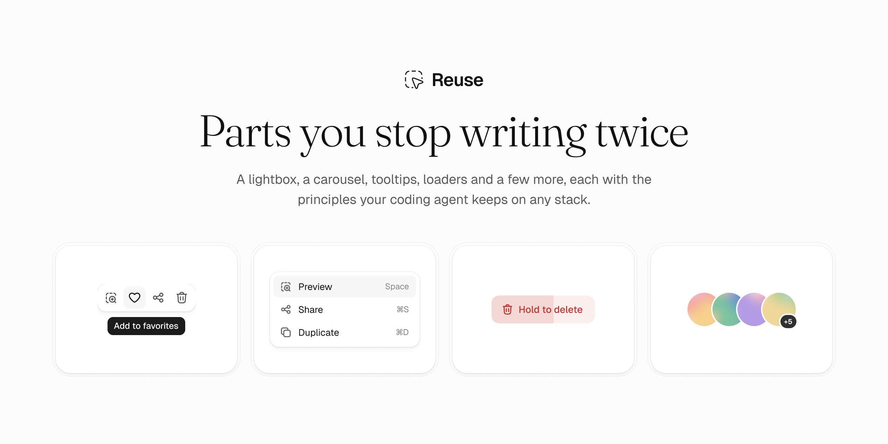

<p align="center">
  <a href="https://reuse.sh">
    <picture>
      <source media="(prefers-color-scheme: dark)" srcset=".github/assets/readme-header-dark.png">
      
    </picture>
  </a>
</p>

<p align="center">
  <a href="https://github.com/reuse-sh/reuse/actions/workflows/ci.yml"></a>
  <a href="https://www.npmjs.com/org/reuse-sh"></a>
  <a href="LICENSE"></a>
  <a href="https://reuse.sh"></a>
  <a href="https://reuse.sh/for-agents"></a>
</p>

Reuse is a set of interface parts we use across many products: a lightbox, a carousel, tooltips, loaders and a few more. Each one is a small browser module with a thin React wrapper, so it works the same in React, Vue, Svelte or a page with no framework.

What carries from one product to the next is not the code but the rules behind it. Every part lists a few principles: how it scrolls, where focus goes, what it cleans up, how it moves. Each part also ships a guide written for coding agents, so your agent can use the part or rebuild it on another stack and keep those rules.

- **Built on the browser.** Native dialogs, CSS scroll snap and CSS animations do the heavy lifting.
- **Leaves the page alone.** Styles are scoped to `re-` classes, and `destroy()` puts back everything a part added.
- **Works from the keyboard.** Real buttons, dialogs and focus order, with reduced motion respected.

## Parts

### Media

- [Lightbox](https://reuse.sh/lightbox), an image viewer that grows out of the thumbnail and zooms into the detail.
- [Carousel](https://reuse.sh/carousel), a scroll-snap strip with drag, loop and autoplay, built on your own markup.
- [Annotations](https://reuse.sh/annotations), areas, arrows and notes on an image, kept in one format your tools can share.

### Interface

- [Avatars](https://reuse.sh/avatars), photos and initials with badges and groups, cut out cleanly on any background.
- [Floating tooltip](https://reuse.sh/floating-tooltip), one shared hint that follows the pointer and slides between triggers.
- [Moving highlight](https://reuse.sh/moving-highlight), one background that slides to the row under the pointer, the focus or the selection.
- [Hold to confirm](https://reuse.sh/hold-to-confirm), a button that acts only after a full press.
- [Copy button](https://reuse.sh/copy-button), a button that copies text, swaps its icon for a check and says what happened.

### Motion and style

- [Loaders](https://reuse.sh/loaders), a few dots that change shape while an answer is on its way.
- [Shadows](https://reuse.sh/shadows), six shadow levels and a hairline ring in one stylesheet, with no JavaScript.
- [Easing gradients](https://reuse.sh/easing-gradients), gradients that follow an easing curve, so a fade ends without a hard edge.

## Use it

Install the package for the part you need:

```sh
npm install @reuse-sh/carousel
```

Each library page has complete runnable examples. Choose React or HTML + JavaScript in the sidebar, then open Code to copy the actual files used by the preview.

- [React with Tailwind](https://reuse.sh/carousel/getting-started?view=code) includes the component, data and package CSS imports. Copy `example.tsx` into a React 19 project with Tailwind CSS 4.
- [HTML + JavaScript](https://reuse.sh/carousel/getting-started?framework=html&view=code) includes `index.html`, `styles.css` and `main.js`. Copy all three into an ES module project such as Vite. The initial markup remains useful before the script runs.

## With a coding agent

Give your agent this prompt:

> Read https://reuse.sh/llms.txt. It lists the Reuse libraries and links a guide for each. Pick the library that fits what I am building and follow its guide. Keep the principles the guide lists.

Every guide opens with the library's principles, then covers the markup, the options, the cleanup and the checks to run. The full list is at [reuse.sh/for-agents](https://reuse.sh/for-agents).

## Develop

Use Node.js 22.13 or newer and pnpm.

```sh
pnpm install
pnpm dev
```

The site runs at http://127.0.0.1:4300 and needs no environment variables. Run `pnpm check` for lint, types, tests, the build and browser tests. [CONTRIBUTING.md](CONTRIBUTING.md) covers the workspace, principles and releases.

## License

MIT. See [LICENSE](LICENSE) and [THIRD_PARTY_NOTICES.md](THIRD_PARTY_NOTICES.md).
